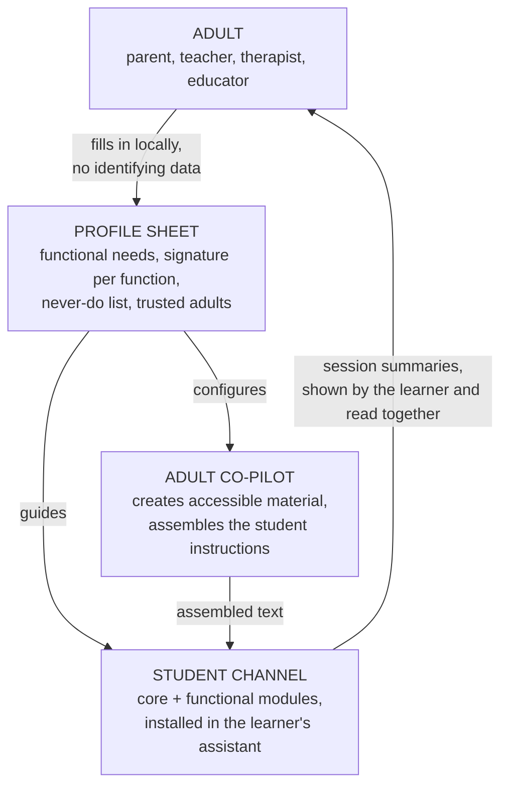

# ADA: Assisted Digital Autonomy

**Open instructions and scaffolding for AI chatbots that work with learners with special educational needs, built so that the learner keeps ownership of their own thinking.**

ADA is not a chatbot. It is the layer that goes *inside* the chatbot a young person already uses: the instructions that shape how it talks, how it behaves, when it steps back, when it hands over to a human, and how it helps adults create learning material. Parents, teachers, therapists and educators download it, fill in a short profile, and "install" it in the assistant they already have (ChatGPT, Gemini, and others).

> **Status: v0.1, early and unvalidated.** Everything here is a starting point to be tested in the field. Read [SAFETY.md](SAFETY.md) before using anything with a young person.

---

## The one idea behind everything

Most AI products are designed to be used more. ADA is designed around a different question:

> **Who decides what matters, and why?**

We call this **epistemic ownership**. An AI that *executes* while the learner *decides* is extending the learner's mind. An AI that *decides* in the learner's place, however kindly, is replacing it. The amount of AI support is not the problem. Where the decisions sit is.

From this follow two legitimate trajectories for any support, and they depend on the **function** being supported, never on the diagnosis:

| | Signature A: support that learns to disappear | Signature B: support that stays, governed |
|---|---|---|
| **When** | The function can mature with practice (e.g. planning, sequencing, organizing an argument) | The function does not mature (e.g. decoding written text in dyslexia) |
| **What decreases** | The amount of help | The *opacity* of the help |
| **What grows** | Independence on the task | Ownership of the tool: knowing what it did, going back to the source, refusing a bad version, keeping one's own voice |
| **A flat support curve means** | Something is wrong | Everything is working |

Nobody asks a wheelchair to fade out. Asking an access tool to make itself unnecessary is not an ambitious goal, it is a clinical error. See [docs/concepts.md](docs/concepts.md).

---

## Two channels, one entry point

The **adult is always the primary user** of this repository, including when the chatbot is used by the young person. The adult installs, configures and stays in the loop; the student channel is never a standalone product handed to a minor.

---

## Quick start (no technical skills needed)

1. **Read [SAFETY.md](SAFETY.md)** and check the [platform compatibility table](docs/platform-compatibility.md): not every assistant allows minors, and the rules differ by age and country.
2. **Fill in the [profile sheet](profile/profile-sheet.md)** on your own computer. It asks about *what the learner needs*, not who they are. Do not write names or diagnoses you would not want stored by a tech company.
3. **Set up the adult co-pilot** by pasting [channels/adult/adult-copilot.md](channels/adult/adult-copilot.md) into a project or custom assistant for yourself. Use it to create material and to assemble the student instructions.
4. **Assemble the student instructions** from [the core](core/core-behavior.md) and the [modules](channels/student/modules/) that match the profile (the co-pilot can do this for you). Follow [docs/how-to-install.md](docs/how-to-install.md).
5. **Agree on it with the learner** using the [study agreement](docs/study-agreement.md). The learner must know the instructions exist. This is a shared study setting, not parental control.
6. **Run the [test scenarios](tests/)** on an adult test account with the same instructions before handing it over, and again whenever the platform updates its model.

---

## What is in here

| Folder | What it contains |
|---|---|
| [`core/`](core/) | The behavior every configuration shares: the non-negotiables |
| [`channels/adult/`](channels/adult/) | The co-pilot for adults and its output templates |
| [`channels/student/`](channels/student/) | The student-facing base and composable **functional modules** |
| [`profile/`](profile/) | The profile sheet that connects the two channels, plus a fictional example |
| [`tests/`](tests/) | Conversation scenarios with expected behavior: how we check that instructions actually work |
| [`docs/`](docs/) | Concepts, installation, platform compatibility, the study agreement |

Modules are organized by **functional need**, not by diagnosis. Diagnostic labels vary by country (SEN, SEND, IEP categories, the Italian BES/DSA) and, more importantly, two learners with the same diagnosis rarely need the same thing. A profile is a *recipe* that combines modules.

---

## What this project is not

- Not a medical device, not a diagnostic tool, not therapy, not a crisis service.
- Not a surveillance system. Adults read *session summaries*, ideally together with the learner, never the conversations behind the learner's back.
- Not a guarantee. Instructions orient a model's behavior; they do not lock it. Models drift, platforms change, and young people are creative. That is why [`tests/`](tests/) exists and why a human stays in the loop.
- Not a replacement for people. Every configuration is built to **connect the learner to people, not substitute for them**.

---

## Contributing

Contributions are welcome from educators, clinicians, researchers, developers, parents and, especially, from neurodivergent people themselves. A new test scenario is worth as much as a new instruction. Start with [CONTRIBUTING.md](CONTRIBUTING.md) and the [style guide](STYLE_GUIDE.md).

Field reports (anonymized) are the most valuable contribution of all: they are how the scaffolding gets calibrated on real learners instead of on paper.

---

## Origin and credits

ADA is derived from the *ADA (Autonomia Digitale Assistita)* clinical-educational framework developed by **Ivan Ferrero**, psychologist, psychotherapist and cyberpsychologist ([ivanferrero.it](https://ivanferrero.it)), in Italian, since April 2026. This repository opens its operational layer (what the original framework calls "context A": configuring an existing general-purpose assistant) so that it can be translated, tested and improved by others.

Theoretical anchors include Vygotsky's scaffolding, Clark and Chalmers' extended mind, attachment theory (Bowlby), the social model of disability and the independent living movement (UPIAS, Oliver, DeJong), interdependence (Kittay, Kafer), and Universal Design for Learning 3.0 (CAST, 2024). See [docs/concepts.md](docs/concepts.md#references).

## License

Content is released under [Creative Commons Attribution-ShareAlike 4.0](LICENSE) (CC BY-SA 4.0): you can use, adapt and share it, including commercially, as long as you credit the source and share adaptations under the same license. Any future code in this repository will be released under the [MIT License](LICENSE-CODE).
